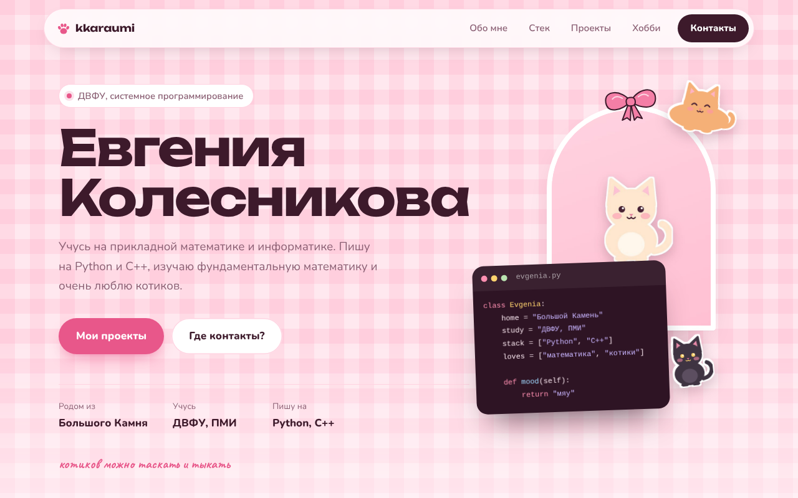
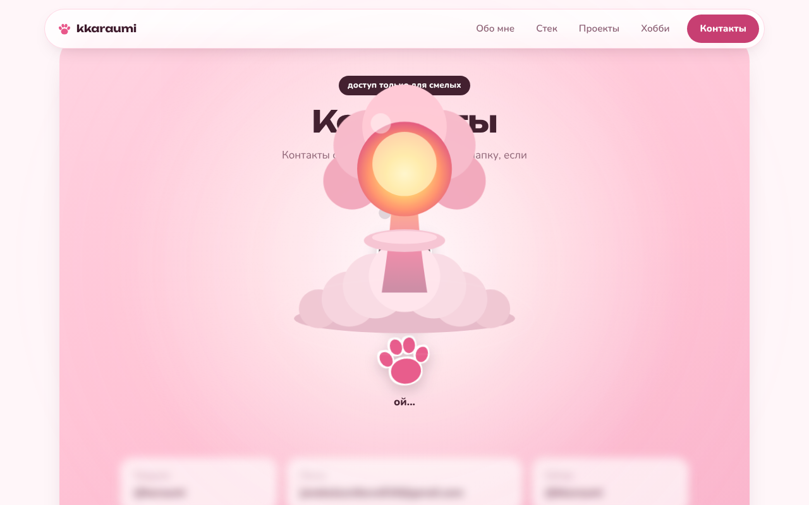
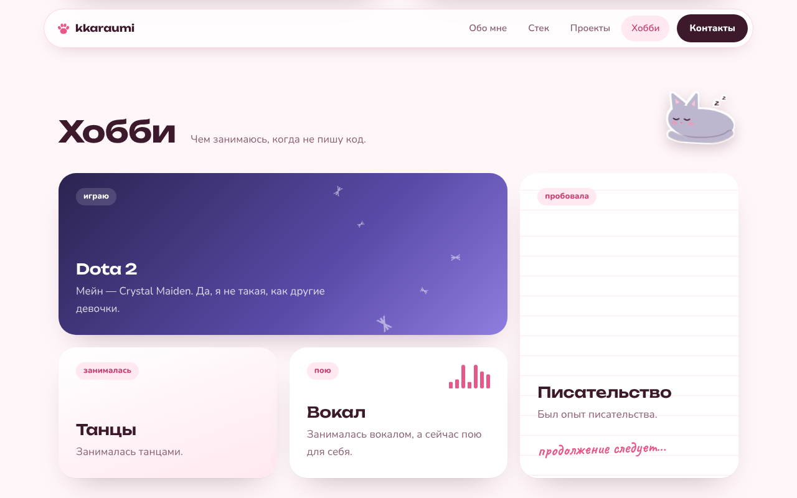
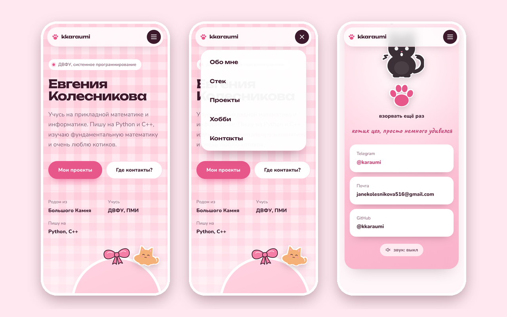

# kkaraumi.ru

Персональный сайт Евгении Колесниковой, студентки ДВФУ (прикладная математика и информатика, профиль «Системное программирование»). Розовый, с котиками и одной взрывной кнопкой.

**Сайт:** [kkaraumi.ru](https://kkaraumi.ru)


[](https://github.com/kkaraumi/kkaraumi-ru/actions/workflows/deploy.yml)
[](LICENSE)
[](https://kkaraumi.ru)

## Как это выглядит

| Главная | Взрыв котика |
|:---:|:---:|
|  |  |
| **Хобби** | **Телефон** |
|  |  |

## Возможности

- Разделы «Обо мне», «Стек», «Проекты», «Хобби» и «Контакты».
- Контакты охраняет котик. Пока он цел, они размыты. После нажатия на лапку котик дрожит, над ним вырастает розовый ядерный гриб, экран вспыхивает, и контакты открываются. Котик остаётся обугленным, но цел.
- Сайт запоминает, сколько взрывов пережил котик.
- Звук взрыва создаётся прямо в браузере. По умолчанию он выключен, выбор сохраняется.
- Окно редактора с файлом `evgenia.py`: код про хозяйку сайта появляется построчно.
- Котиков-стикеров можно перетаскивать, а если ткнуть, они отвечают «мяу».
- Превью проектов нарисованы на CSS: поле «Морского боя» и мини-браузер с этим сайтом.
- Меню подсвечивает текущий раздел, на телефоне открывается бургером.
- Отдельная вёрстка для телефона, без горизонтальной прокрутки на ширине от 360 px.
- Учитывается настройка «уменьшить движение» (`prefers-reduced-motion`), работает навигация с клавиатуры.
- Сайт работает и без localStorage, например в режиме инкогнито.

## Технологии

| Что | Зачем |
|---|---|
| HTML5 | Разметка страницы, семантические разделы, SVG-спрайт с котиками |
| CSS3 | Сетка, адаптивная вёрстка, анимации взрыва и окна кода |
| JavaScript (ES-модули) | Отрисовка разделов из данных, меню, фишки сайта |
| IntersectionObserver | Подсветка текущего раздела в меню |
| Web Audio API | Звук взрыва без аудиофайлов |
| localStorage | Счётчик взрывов и настройка звука |
| Google Fonts | Шрифты Unbounded, Nunito и Caveat |
| GitHub Actions | Автоматическая выкладка на хостинг по FTP |

Фреймворков, сборщиков и npm-зависимостей нет.

## Структура проекта

```
kkaraumi-ru/
├── index.html               разметка страницы и мета-теги
├── assets/
│   ├── css/
│   │   └── style.css        все стили, включая мобильную вёрстку
│   ├── img/
│   │   ├── favicon.svg      иконка сайта (лапка)
│   │   └── photo.jpg        фото на главной
│   └── js/
│       ├── main.js          точка входа: запуск модулей, меню, подсветка раздела
│       ├── content.js       все тексты и данные разделов
│       ├── render.js        заполнение страницы из content.js
│       ├── dom.js           общие функции для работы с DOM
│       ├── storage.js       безопасная работа с localStorage
│       ├── code-window.js   окно кода evgenia.py
│       ├── stickers.js      котики-стикеры: перетаскивание и «мяу»
│       ├── cat-bomb.js      взрыв котика и открытие контактов
│       └── sound.js         звук взрыва и переключатель звука
├── docs/
│   └── screenshots/         скриншоты для README
└── .github/
    └── workflows/
        └── deploy.yml       выкладка на хостинг при push в main
```

Чтобы поменять текст на сайте, достаточно открыть `assets/js/content.js`.

## Запуск локально

Сайт использует ES-модули, поэтому его нужно открыть через локальный сервер, а не двойным кликом по `index.html`:

```bash
git clone https://github.com/kkaraumi/kkaraumi-ru.git
cd kkaraumi-ru
python -m http.server 8000
```

Затем открыть в браузере http://localhost:8000.

## Размещение

Сайт размещён на хостинге Рег.ру, домен `kkaraumi.ru`.

1. Домен и хостинг куплены на Рег.ру, домен привязан к хостингу.
2. Данные администратора домена подтверждены через Госуслуги, без этого домен .ru не работает.
3. В панели ispmanager для сайта выпущен бесплатный сертификат Let's Encrypt и включено перенаправление с HTTP на HTTPS.
4. Файлы попадают на хостинг автоматически: при каждом push в ветку `main` GitHub Actions загружает их по FTP в папку `www/kkaraumi.ru/`. Данные для FTP хранятся в секретах репозитория.

## Лицензия

Код распространяется по лицензии [MIT](LICENSE). Фотографии и тексты о себе принадлежат автору и под лицензию не попадают.
